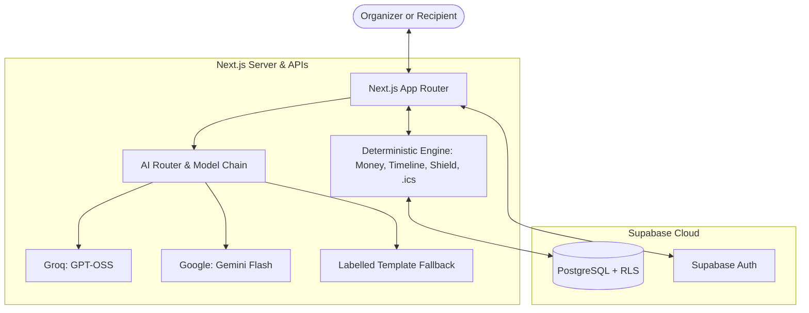

<div align="center">

#  Closer

**Plan something that brings you closer.**

An AI-assisted, human-approved celebration companion that helps you make someone feel loved, understood, and special, and then handles the logistics.

<p align="center">
  <a href="https://closer-planner.vercel.app/">
    
  </a>
</p>

<p align="center">
  
  
  
  
  
</p>

*Tell us about them → Get a personal plan → Approve every change → Surprise them*

</div>

---

## 📌 Overview

Most celebration planning software starts with tasks, spreadsheets, and line items. Closer starts with the person: who they are, what they love, and how you hope they will feel.

Once that emotional direction is clear, Closer turns it into a concrete plan with a budget, a timeline, backup options, and vendor help. The AI drafts and suggests. Plain, tested code does the maths, and you approve every change.

<!-- screenshots: add later -->

Closer currently supports:
- 💡 **Three ways to start a plan**: guided discovery, concrete vision, or rapid tonight-flow
- 💰 **Code-computed budget and timeline**: integer minor units, no floating-point drift, validated dependency graphs
- 🔁 **Change proposals with undo**: AI proposes trade-offs; applying creates snapshots with instant rollback
- 🤝 **Vendor suggestions & quote parsing**: extract structured quotes from raw WhatsApp or email text
- 🎁 **Surprise Shield**: keep budgets, notes, and early ideas strictly confidential from the recipient
- 💌 **Letters from loved ones**: collect messages from friends and family with an organizer moderation step
- 🫶 **Our Blend**: compare co-planner perspectives to find agreement and plan better
- 📅 **Countdown & .ics export**: live countdown, minute-by-minute run sheet, and calendar sync
- 🎨 **Invitation mini-site**: customizable card exportable as PNG, HTML, or email draft
- 🎙️ **Voice input**: speech recognition in English and Hindi
- 🔑 **Bring Your Own Key (BYOK)**: use personal Groq or Gemini keys session-wide

---

## 💡 Why Closer?

| Typical Planning Tools | Closer |
|---|---|
| Start with tasks and line items | Starts with the person and how you want them to feel |
| Budget arithmetic is loose or left to a chat model | Money is computed by code in integer minor units |
| Changes quietly overwrite the plan | Changes are proposed, approved, versioned, and undoable |
| Surprises can be spoiled by a shared link | Surprise Shield is enforced on the server |
| AI failures leave you with nothing | A clearly labelled template fallback keeps working |
| Prices look more certain than they are | Costs are only ever an estimate or a quote, never "confirmed" by AI |

---

## ⚠️ Honest by Design

Closer is a hackathon project and a planning aid, not a booking service.
- **AI suggestions are proposals**: You review and approve every decision.
- **Costs are estimates or quotes**: The AI cannot mark a price as confirmed.
- **Explicit fallbacks**: When the AI is unavailable, Closer says so and uses a labelled template (`source: "fallback"`).
- **Your key stays yours**: A request using your own API key never silently falls back to the server's key.
- **Known limitations** are listed openly below.

---

## ✨ Key Features

- 💡 **Three Ways to Start**: "I have an idea", "Help me discover" (gentle questions about the person), and "I need it now" (fast path for tonight or this week).
- 💰 **Plan, Budget, and Timeline**: Budget totals and over-budget warnings are calculated by code, not AI. The timeline is validated as a Directed Acyclic Graph so tasks never loop.
- 🔁 **Change Engine with Undo**: When date, budget, or guest count changes, AI proposes trade-offs that preserve emotional intent. Every apply creates a snapshot for one-click rollback.
- 🤝 **Vendors and Quote Parsing**: Vendor suggestions, a parser for pasted vendor emails or WhatsApp messages (with prompt-injection defences), and pre-drafted inquiries.
- 🎁 **Surprise Shield**: A recipient link that reveals nothing before the reveal time.
- 💌 **Letters from Loved Ones**: A contribution link for friends and family, with an organizer review gate.
- 🫶 **Our Blend**: A short quiz comparing how the organizer and a friend understand the recipient's tastes.
- 📅 **Calendar and Countdown**: Live countdown, run sheet, optional browser reminders, and RFC 5545 `.ics` export.
- 🎨 **Invitation**: A customizable invitation card, exportable as PNG or clean HTML, plus an email draft.
- 🎙️ **Voice Input**: Speech input on the intake form, with an English and Hindi toggle.
- 🔑 **Bring Your Own Key (BYOK)**: Use your own Groq or Gemini key for the browser session.

---

## 🧠 How Closer Works



### 🔍 AI Proposes, Code Decides

1. **Intake**: You pick one of three paths and describe the person and the occasion.
2. **AI Draft**: The server calls an ordered chain of models (`AI_MODEL_CHAIN`). Rate limits, server errors, and timeouts trigger backoff and rollover. Failing models enter a 60-second cooldown.
3. **Validation**: Responses are parsed against strict Zod schemas. Invalid output is retried once, then replaced by the labelled template fallback.
4. **Code Takes Over**: `src/lib/engine` holds the plain, tested logic. Money is handled in integer minor units (no floating-point drift). Budget, timeline DAGs, version history, Shield rules, and `.ics` export all live there.
5. **You Approve**: Changes are proposed, shown to you, and applied only after approval. Each apply creates a version snapshot you can restore.
6. **Share & Run**: Share through the Shield, collect letters, send invitations, then follow the countdown and minute-by-minute run sheet.

---

## 🎁 Surprise Shield

- **Cryptographic tokens**: Share tokens are 32 random bytes. Only a SHA-256 hash is stored, so a database leak cannot reveal a working link.
- **Server-enforced**: Before `reveal_at`, the server returns a neutral cover state with no message and no letters.
- **Identical 404s**: Expired, revoked, unpublished, and unknown tokens all return the same generic 404 response.
- **Privacy headers**: Recipient endpoints send `Cache-Control: no-store` and `Referrer-Policy: no-referrer`.

---

## 🔐 Security

- **Row Level Security**: Enabled across all tables in `schema.sql`. Users can only access their own records.
- **Headers**: Content Security Policy, `X-Frame-Options: DENY`, `X-Content-Type-Options: nosniff`, and HSTS (see `next.config.ts`).
- **Rate limiting**: PostgreSQL-backed `rate_limit_hit()` with an in-memory fallback (10 requests / 60 seconds on AI endpoints).
- **BYOK**: Keys live in browser `sessionStorage` for the tab session, are sent per request in custom headers, and are never stored or logged server-side.
- **Server-only secrets**: The Supabase service-role client and the environment loader import `server-only`.

---

## 🛠️ Tech Stack

| Component | Technology | Purpose |
|---|---|---|
| **Framework** | Next.js 16.4.3 (App Router), React 19.3.0 | Pages and API routes |
| **Language** | TypeScript 5 | Type safety |
| **Styling** | Tailwind CSS v4, Framer Motion 14.7.1 | Blush & Botanical UI and motion |
| **Database & Auth** | Supabase (`@supabase/ssr` 0.12.7, `@supabase/supabase-js` 2.118.0) | Postgres, RLS, anonymous & Google sign-in |
| **AI** | Vercel AI SDK `ai` 7.0.155 (Groq, Google Gemini) | Model chain, structured output, and failover |
| **Validation** | Zod 4.6.7, DOMPurify 3.4.17 | Output validation and sanitization |
| **Export** | html-to-image 1.11.13 | Invitation PNG export |
| **Testing** | Vitest 5.0.5 (PGlite 0.5.12), Playwright 1.64.1 (axe-core 4.14.0) | Unit, database, end-to-end, and a11y tests |
| **Hosting** | Vercel and Supabase | Production cloud deployment |

---

## 📂 Project Structure

```
Closer/
├── src/
│   ├── app/                 # App Router pages and API routes
│   │   ├── plan/[id]/       # Plan dashboard
│   │   ├── r/[token]/       # Surprise Shield recipient view
│   │   └── contribute/      # Letters from loved ones
│   ├── components/          # UI components
│   ├── fonts/               # Self-hosted fonts (SIL Open Font License)
│   ├── lib/
│   │   ├── ai/              # Orchestrator, router, prompts, schemas, BYOK client
│   │   ├── engine/          # Deterministic logic (money, budget, timeline, shield, ics)
│   │   ├── security/        # Rate limiting, sanitization
│   │   └── supabase/        # Browser, server, and admin clients
│   └── proxy.ts             # Session refresh and route protection
├── tests/                   # Vitest, security, and Playwright tests
├── schema.sql               # Tables, constraints, RLS, rate limiting
├── .env.example
└── README.md
```

---

## ⚙️ Requirements

- Node.js 20.9 or newer
- npm
- A Supabase project
- A Groq and/or Google AI Studio API key for AI features

---

## 🚀 Installation

```bash
# 1. Clone the repository
git clone https://github.com/prakashkamath1926/Closer-Planner.git
cd Closer-Planner

# 2. Install dependencies
npm install

# 3. Configure the environment
cp .env.example .env.local
```

*On Windows PowerShell, use `Copy-Item .env.example .env.local` instead. Fill in values; never commit `.env.local`.*

**Environment variables:**
- `NEXT_PUBLIC_SUPABASE_URL`
- `NEXT_PUBLIC_SUPABASE_ANON_KEY`
- `SUPABASE_SERVICE_ROLE_KEY`
- `AI_MODEL_CHAIN`
- `GROQ_API_KEY`
- `GOOGLE_GENERATIVE_AI_API_KEY`
- `APP_BASE_URL`
- *Optional:* `COMPAT_BASE_URL`, `COMPAT_API_KEY`, `COMPAT_LABEL`, `SUPABASE_PROJECT_REF`

```bash
# 4. Set up the database
# Execute schema.sql in your Supabase project's SQL editor

# 5. Run the development server
npm run dev # http://localhost:3000
```

**Verification commands:**
```bash
npm run typecheck       # TypeScript verification
npm run lint            # ESLint check
npm test                # Vitest unit & schema tests on PGlite
npm run test:e2e        # Playwright end-to-end tests
npm run build           # Production Next.js build
```

---

## ☁️ Deployment

Closer runs on Vercel with a Supabase backend.

1. **Anonymous sign-ins**: Enable in **Authentication > Sign In / Up**. Allows immediate planning without signup.
2. **Email provider**: Enable in **Authentication > Providers > Email**.
3. **Google sign-in**: Enable the Google provider.
   - In Google Cloud Console, set the Authorized Redirect URI to Supabase's callback: `https://<project-ref>.supabase.co/auth/v1/callback`.
   - In Supabase (**Authentication > URL Configuration > Redirect URLs**), add `https://<your-domain>/auth/callback`.
4. **Site URL**: Set your production domain in Supabase URL Configuration (e.g. `https://closer-planner.vercel.app`).
5. **Database**: Run `schema.sql` in the Supabase SQL editor.
6. **Environment variables**: Add the environment variables in Vercel Project Settings.

---

## ⚠️ Known Limitations

- **Multi-step change apply**: Applying a change makes sequential database writes rather than one atomic transaction.
- **Client-bound reminders**: Reminders only fire while the browser tab remains open.
- **CSP unsafe-inline**: The CSP permits `'unsafe-inline'` for script and style tags to accommodate runtime hydration.
- **Rate limiting scope**: The in-memory rate limiter and model cooldown are per server instance.
- **Integration test gating**: Live Supabase RLS tests only run with `SUPABASE_INTEGRATION_TEST=true`; standard CI uses embedded PGlite.
- **Pre-confirmed signups**: Accounts are created pre-confirmed without an outbound email verification roundtrip.

*See [`AUDIT-SECURITY.md`](AUDIT-SECURITY.md) for the detailed security audit.*

---

## 🤖 Built with AI

Generative AI helped draft code, schemas, tests and prompts, and it is also part of the product. The developer set the product direction and the rules (honest by design, human approval for changes, the Shield enforced on the server), chose between options, and ran the tests, reviews and security audit. Full prompts and design evolutions are in [`PROMPT_LOG.md`](PROMPT_LOG.md).

---

## 📚 Docs Index

- [`prd.md`](prd.md) — Product requirements
- [`architecture.md`](architecture.md) — System design and boundaries
- [`design.md`](design.md) — Blush & Botanical design tokens
- [`rules.md`](rules.md) — Project development invariants
- [`DEPLOY.md`](DEPLOY.md) — Deployment checklist
- [`PROMPT_LOG.md`](PROMPT_LOG.md) — Prompt history and evolution

---

## 🏆 Built For

**PromptWars Virtual Challenge 5: Celebration & Event Planner**

### 👨‍💻 Author
**Prakash Kamath** — Design, development, AI architecture, and engineering.

---

<div align="center">

 **Closer**  
*Because making someone feel special matters.*  
Built with Next.js 16, Supabase, Vercel AI SDK, Groq, and Gemini.

</div>
